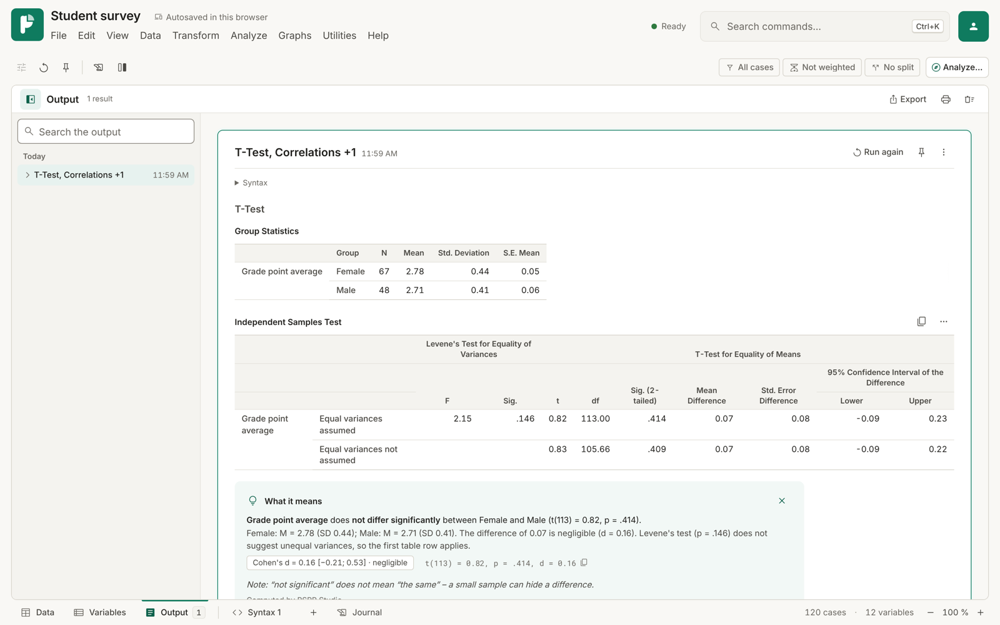
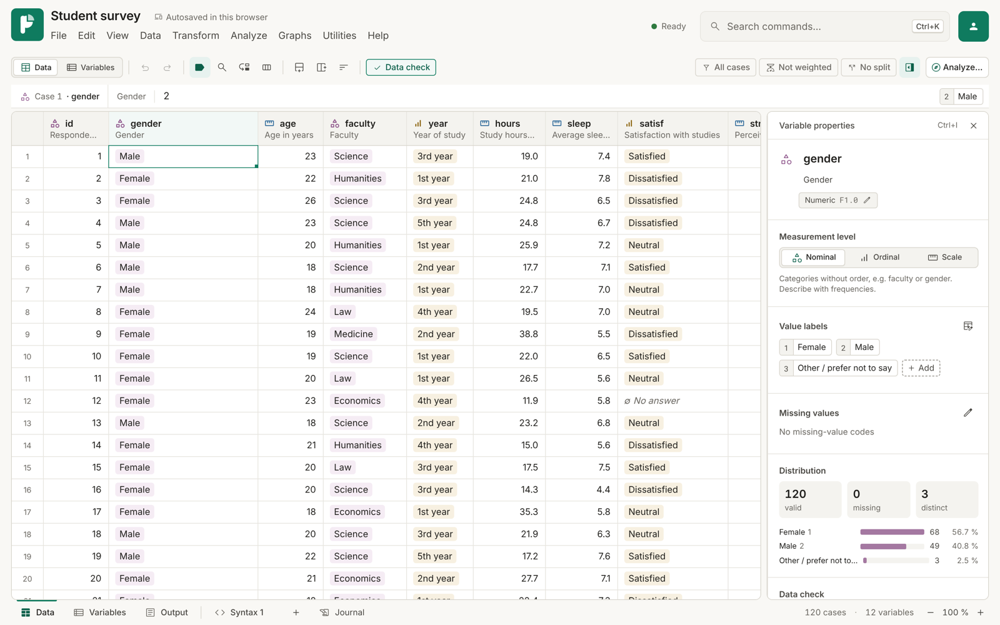
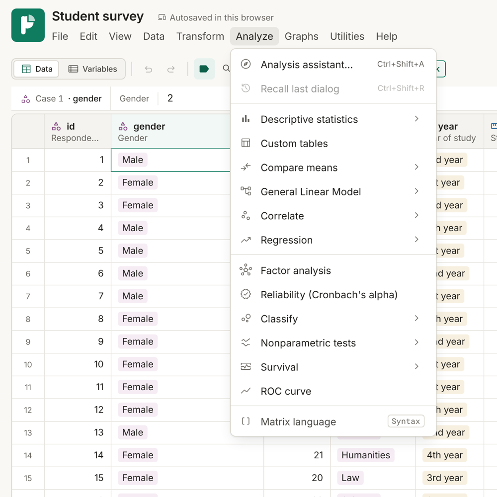
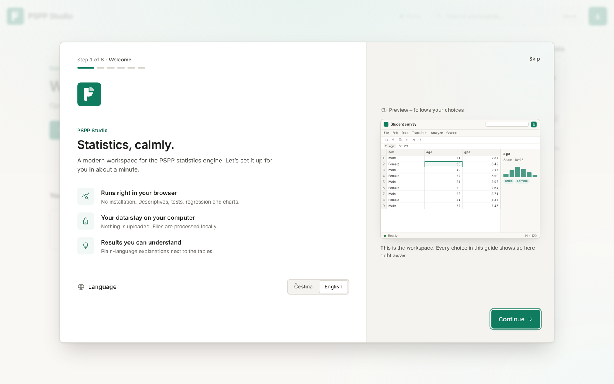
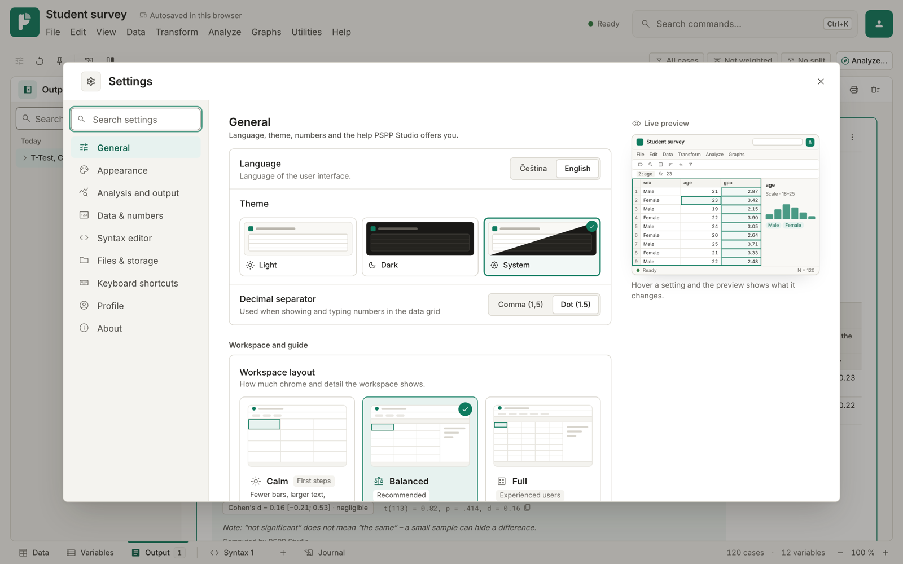
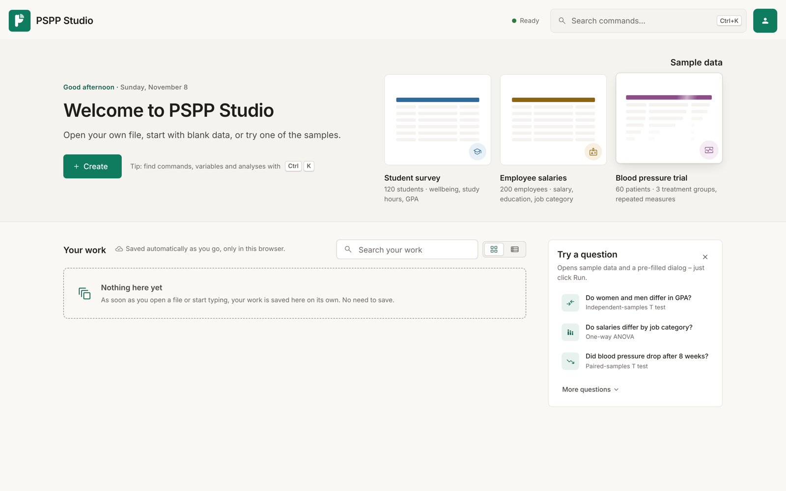
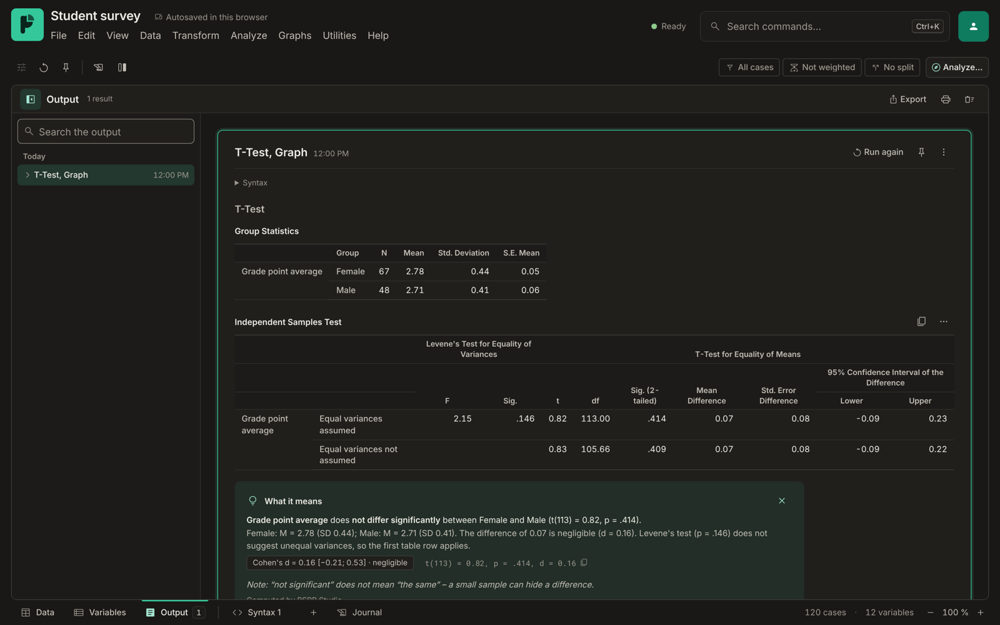

# PSPP Studio

**A modern, friendly user interface for [GNU PSPP](https://www.gnu.org/software/pspp/) that runs entirely in your browser.**

PSPP is a free alternative to SPSS with an excellent statistical core. PSPP Studio puts a
new interface on top of the original engine, compiled to WebAssembly: nothing to install,
and your data stays on your computer unless you choose to sign in to the optional, invitation-only cloud account (see `server/`). It is available in English and Czech.

**Live demo: <https://pspp-studio.vercel.app>**



## Why

PSPP Studio started at a university that wanted a user-friendly free alternative to SPSS for
students. PSPP has a solid foundation, but it lacked some analyses and its interface looked
dated and was hard to find your way around. This project adds the missing pieces on top of the
unchanged statistics engine.

## Features

- **Dialogs for the common procedures** (descriptives, t-tests, ANOVA, regression, correlations,
  charts, and more) that generate and show the PSPP syntax, next to a full syntax editor.
- **Data grid and variable view** with value labels, a variable inspector, undo/redo and autosave
  in the browser.
- **Extra analyses** PSPP does not have, computed in the browser on top of the engine: GLM with
  repeated measures and profile plots, line charts, Cox regression, Kaplan–Meier, cluster
  analysis, discriminant analysis, and more.
- **Plain-language explanations** of results, with effect sizes, for people new to statistics.
- **Import and export:** SAV, ZSAV, POR, CSV/TSV, Excel (.xlsx), OpenDocument (.ods) and JSON.
- **Output export** to PDF, Word (.docx) and HTML, with tables and charts.
- **Charts** drawn from the engine's chart data (histogram, bar, pie, box plot, scatter, ROC,
  survival, dendrogram, and more), exportable as SVG and PNG.
- **A guided first-run setup** and a settings page with a live preview; light and dark themes.

| | |
|---|---|
|  |  |
|  |  |
|  |  |

## Repository layout

| Path | What |
|---|---|
| [`engine/`](engine/README.md) | GNU PSPP 2.1.3 sources with small changes, a C bridge, and scripts that build the WebAssembly engine |
| [`web/`](web/README.md) | The React/TypeScript front end |
| [`server/`](server/README.md) | Optional invitation-only accounts: a Cloudflare Worker (free plan) that saves documents online |
| [`mcp/`](mcp/README.md) | MCP server that lets AI agents load data and run PSPP analyses locally (no browser needed) |
| `vercel.json` | Static deployment configuration |

## Quick start

Requires Node.js 22. The compiled engine is committed, so Emscripten is not needed to run the app.

```bash
cd web
npm install
npm run dev
```

See [`web/README.md`](web/README.md) for development details and [`engine/README.md`](engine/README.md)
for rebuilding the engine.

## How it was made

Most of the front-end code, and the bridge and build scripts around the engine, were written with
the help of an AI model (Anthropic's Claude), under the author's direction and review.

## License

GNU General Public License v3.0 or later, like GNU PSPP itself (see [LICENSE](LICENSE)).

PSPP Studio is an independent project. It is not endorsed by, or affiliated with, the GNU Project
or the Free Software Foundation. SPSS is a trademark of IBM Corp.; this project is not related to IBM.
